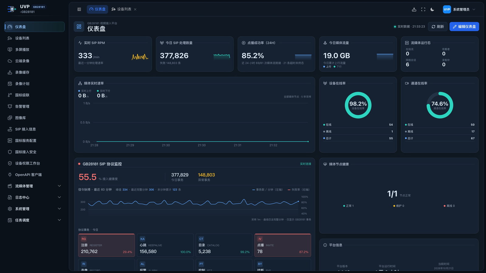
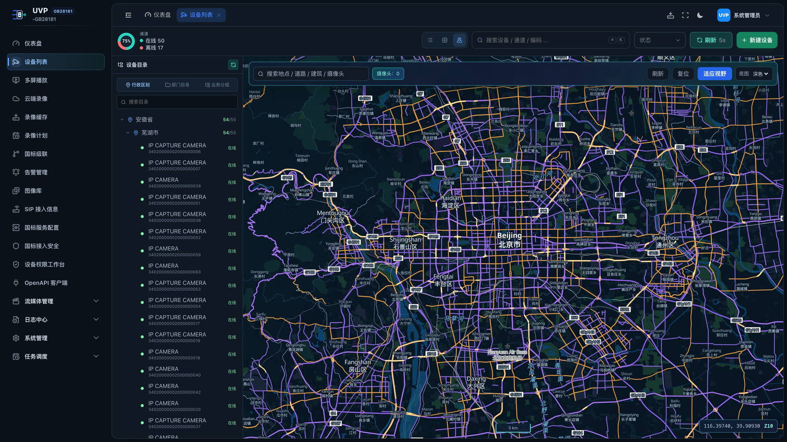
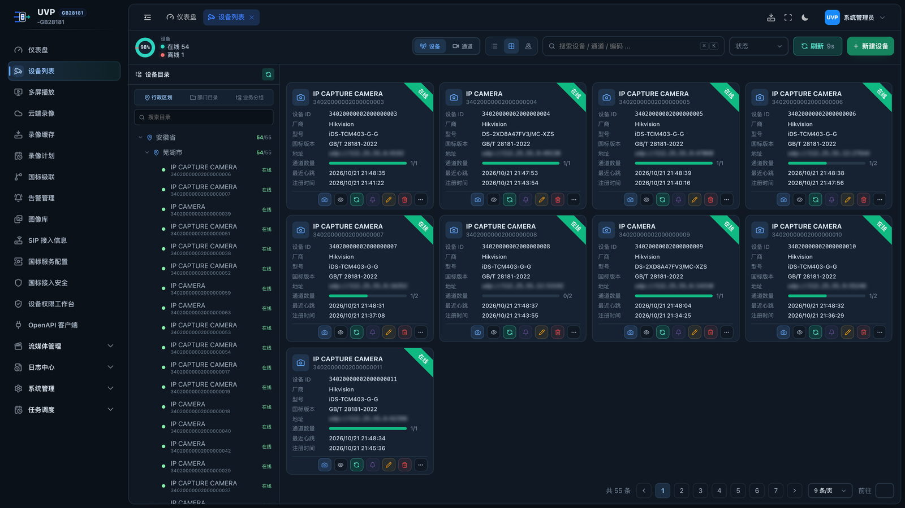
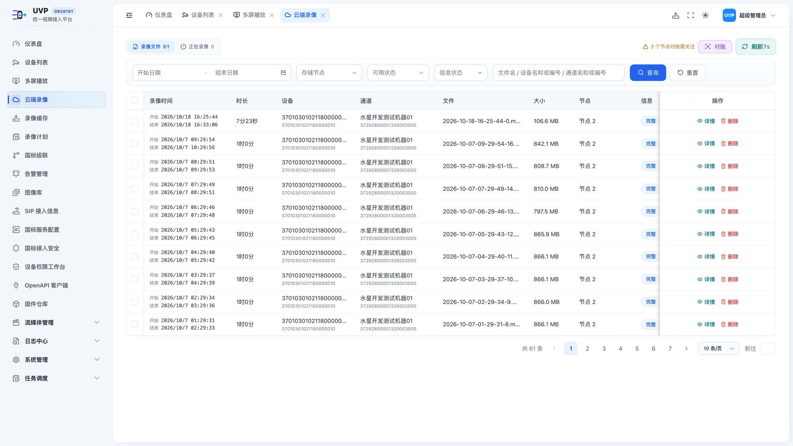
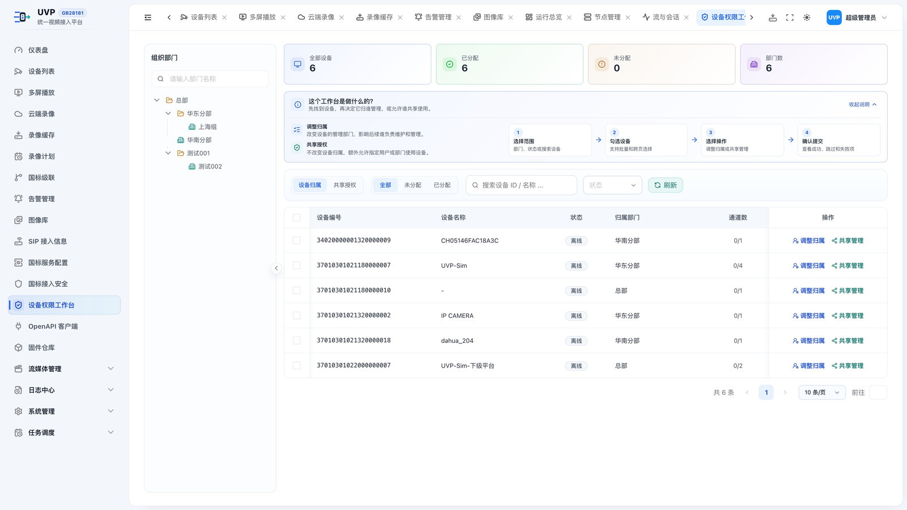
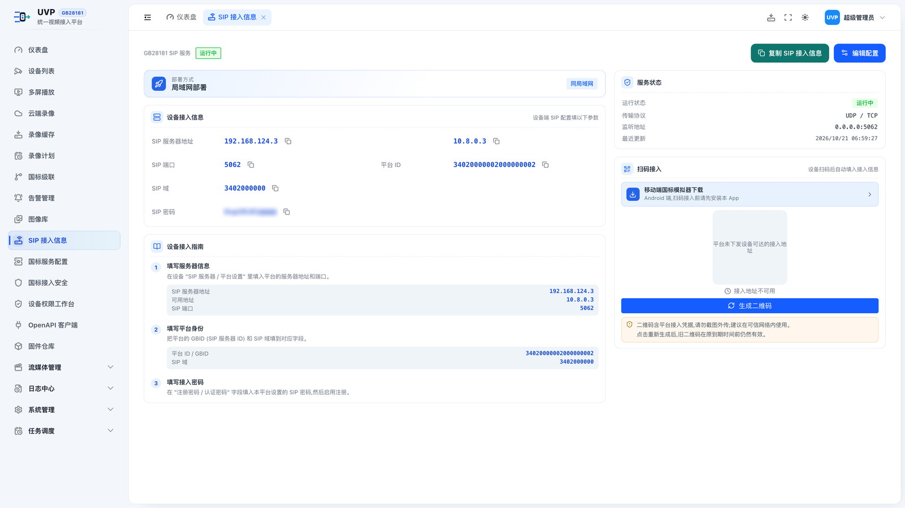
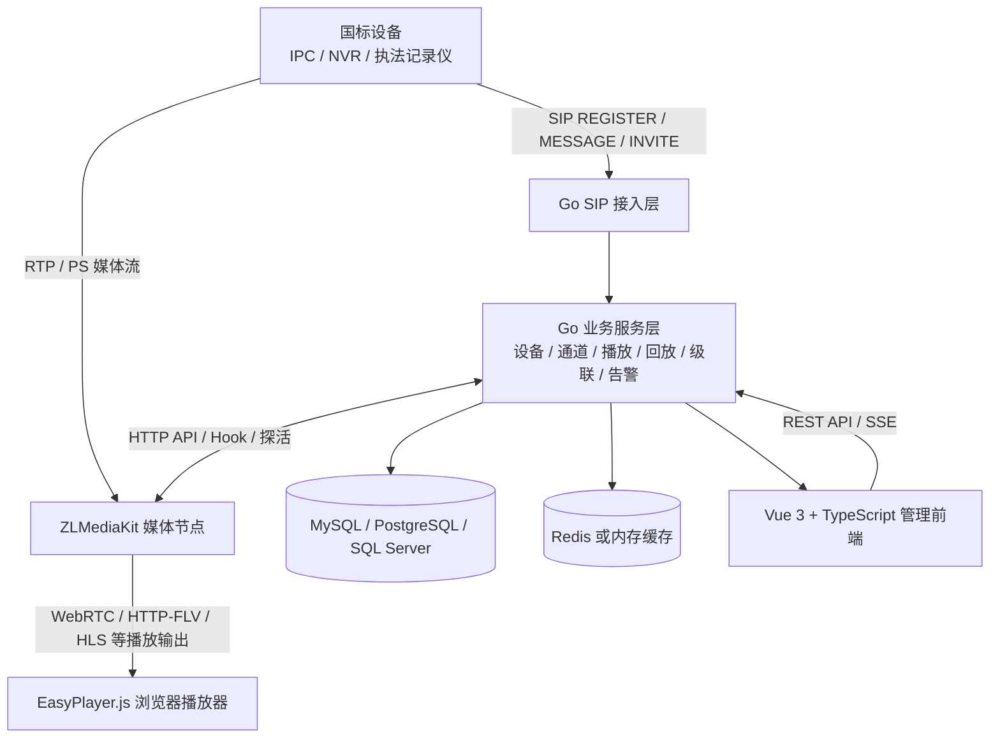

<p align="center">
  <picture>
    <source media="(prefers-color-scheme: dark)" srcset="https://raw.githubusercontent.com/Frank-Coding97/uvp-gb28181/develop/web/src/assets/logo/uvp-wordmark-light.svg">
    
  </picture>
</p>

<h1 align="center">UVP-GB28181</h1>

<p align="center">
  <b>Unified Video Platform · 统一视频接入平台</b><br/>
  面向 GB/T 28181 视频接入场景的统一管理平台，让设备接入、媒体调度和问题排查都有迹可循。
</p>

<p align="center">
  <a href="https://github.com/Frank-Coding97/uvp-gb28181/releases"></a>
  
  
  
</p>

<p align="center">
  
  
  
  <a href="LICENSE"></a>
</p>

UVP 是 **Unified Video Platform** 的缩写，中文全称为 **统一视频接入平台**。UVP-GB28181 是一套面向安防视频联网场景的统一视频接入与管理平台。项目采用 Go、Vue 3 和 TypeScript 构建，并集成 ZLMediaKit 提供媒体处理能力，目标是让国标设备接入更容易部署、更便于运维，也更容易定位问题。

- 当前版本：`1.1.12`（见根目录 `VERSION`）
- 许可证：MIT
- 代码托管：[GitHub](https://github.com/Frank-Coding97/uvp-gb28181) · [Gitee](https://gitee.com/Frank-Coding/uvp-gb28181)

## 目录

- [项目亮点](#项目亮点)
- [功能一览](#功能一览)
- [界面预览](#界面预览)
- [技术架构](#技术架构)
- [快速开始](#快速开始)
- [目录结构](#目录结构)
- [配置说明](#配置说明)
- [开发与质量](#开发与质量)
- [文档索引](#文档索引)
- [常见问题](#常见问题)
- [版本与发布](#版本与发布)
- [项目背景](#项目背景)
- [致谢](#致谢)
- [许可证](#许可证)
- [法律声明与免责](#法律声明与免责)
- [联系我](#联系我)
- [请作者喝杯咖啡](#请作者喝杯咖啡)

## 项目亮点

- **面向真实现场问题设计**：围绕设备注册不上线、心跳掉线、信令成功但无画面、媒体卡顿、录像回放失败等常见问题，设计完整的状态记录和排查链路。
- **国标接入与媒体能力分层**：Go 后端负责 SIP 信令、GB/T 28181 协议处理、设备状态和业务编排，ZLMediaKit 负责媒体接入、转发、录制和协议输出，便于独立扩展与故障定位。
- **可观测、可追溯**：支持 SIP 报文和会话追踪、设备状态事件、媒体流生命周期、节点健康检查、流媒体探针、实时业务日志和安全事件查看，帮助定位问题发生在哪一层。
- **多媒体节点管理**：支持对多个 ZLMediaKit 节点进行接入、配置、探活、维护和运行监控，并提供轮询、加权和最小负载等调度策略。
- **设备与通道统一管理**：提供国标目录树、设备和通道管理、自定义分组、收藏、部门级数据隔离以及设备授权共享能力。
- **覆盖常用视频业务**：支持实时点播、录像检索与回放、云端录像、录像计划、多画面播放、云台控制、预置位、巡航、告警、移动位置和语音对讲等场景。
- **支持平台级联**：提供上级平台级联配置、目录共享和目录推送能力，适配跨平台的视频资源共享场景。
- **兼顾协议演进**：以 GB/T 28181-2016 兼容为基础，持续完善 GB/T 28181-2022 的版本识别、信令字段和设备能力适配；具体能力以设备支持情况和项目当前版本为准。
- **配套模拟器便于联调**：提供配套的国标设备模拟器，用于没有真实设备时的注册、目录、点播和协议问题复现。
- **部署路径清晰**：后端编译为 Go 程序，前端独立构建，数据库、缓存和媒体节点按职责拆分，适合开发联调、单机部署和按需扩展。

## 功能一览

> 下表按业务域归类，均为当前版本已实现并在页面上可用的能力；协议细节层面的兼容程度仍以具体设备的实现为准。

| 业务域 | 能力 |
| --- | --- |
| 设备接入 | 国标注册与鉴权、心跳保活、注册有效期协商、设备上下线状态、设备接入地址生成、设备导入与批量维护 |
| 目录与资源 | 目录查询与订阅、通道树、自定义业务分组、收藏、设备授权共享、部门级数据隔离 |
| 实时视频 | 单画面/多画面点播、主辅码流切换、WebRTC / HTTP-FLV / HLS 播放协议切换、播放会话管理 |
| 录像业务 | 设备录像检索、按时间回放、多屏同步回放、云端录像、录像计划、设备录像缓存到服务器、回放与下载日志 |
| 云台与控制 | 云台方向/变倍/聚焦控制、预置位、巡航、看守位、雨刷与辅助开关、目标跟踪框 |
| 告警与位置 | 告警接收与查询、移动位置上报、订阅与通知 |
| 语音对讲 | 设备语音对讲与语音广播 |
| 平台级联 | 上级平台级联配置、目录共享与推送、级联点播与录像回放、级联状态查看 |
| 媒体节点 | 多 ZLMediaKit 节点接入与配置、节点探活与重启、调度策略（轮询/加权/最小负载）、ZLM Hook 凭证管理 |
| 运维排障 | SIP 报文与会话追踪、实时业务日志、流媒体探针与诊断、节点健康检查、系统任务与操作日志 |
| 图像与固件 | 抓图与图像库、批量下载、固件仓库与升级任务 |
| 平台管理 | 用户/角色/菜单/部门/字典/API 权限、登录安全（验证码、失败锁定）、安全事件、OpenAPI 客户端与凭证 |
| 系统能力 | 多数据库支持（MySQL / PostgreSQL / SQL Server / SQLite）、Redis 或内存缓存、服务在线升级、HTTPS 与端口可配置 |

## 界面预览

> 截图取自我们的开发环境与现场部署环境；图中设备编码为设备出厂默认值，IP 地址与口令已做脱敏。点击图片可查看原图。

### 暗色主题

<table>
<tr>
<td width="50%" align="center">

<b>仪表盘</b><br>
<sub>实时 SIP RPM、今日事务量、点播成功率、设备与通道在线率、协议事务分布，一屏看清平台当天在干什么</sub>
</td>
<td width="50%" align="center">

<b>设备地图</b><br>
<sub>MapLibre 暗色底图，与国标目录树联动筛选；设备上报经纬度后按视野聚合打点，可查看单个终端的移动轨迹</sub>
</td>
</tr>
<tr>
<td colspan="2" align="center">

<b>设备列表</b><br>
<sub>左侧国标目录树（行政区划 / 部门目录 / 业务分组），右侧设备卡片直显在线状态、厂商型号、通道数与最近心跳</sub>
</td>
</tr>
</table>

### 亮色主题

<table>
<tr>
<td colspan="2" align="center">

<b>云端录像</b><br>
<sub>按设备 / 通道 / 时间检索录像文件，展示时长、文件大小、存储节点与可用性，支持对账与详情回溯</sub>
</td>
</tr>
<tr>
<td width="50%" align="center">

<b>设备权限工作台</b><br>
<sub>把“设备归属哪个部门、还能给谁用”做成一条可视化流程：选范围 → 勾设备 → 选操作 → 确认提交</sub>
</td>
<td width="50%" align="center">

<b>SIP 接入信息</b><br>
<sub>把设备侧要填的服务地址、端口、平台 ID、域和密码集中呈现，支持扫码录入与配套模拟器下载</sub>
</td>
</tr>
</table>

## 技术架构

UVP-GB28181 采用“信令控制面、业务管理面、媒体数据面分层”的架构。设备通过 SIP 与平台交互，媒体流由 ZLMediaKit 接收和处理，管理端通过 Web API 和浏览器播放器完成操作与预览。



### 各层职责

| 层次 | 主要职责 | 主要技术 |
| --- | --- | --- |
| 设备与协议层 | 设备注册、鉴权、心跳、目录、点播、回放、设备控制、告警和订阅等国标交互 | SIP、MANSCDP、SDP、RTP/PS、GB/T 28181-2016/2022 |
| 后端业务层 | 设备与通道管理、播放会话、录像计划、云端录像、级联、权限、安全和运维接口 | Go、Gin、GORM、Casbin、JWT、Swagger |
| 媒体数据层 | RTP 接收、媒体转发、录制、协议转换、流状态和节点运行能力 | ZLMediaKit、HTTP API、Hook |
| 数据与任务层 | 业务数据持久化、缓存、异步探针、调度记录和运行状态 | MySQL / PostgreSQL / SQL Server、Redis |
| 管理与播放层 | 管理页面、设备树、播放控制台、录像工作台、节点工作台和实时状态展示 | Vue 3、TypeScript、Vite、Arco Design、EasyPlayer.js |

### 一次实时点播的基本流程

1. 用户在管理前端选择设备或通道，后端校验权限并创建播放会话。
2. Go 信令与业务层通过 SIP 向设备发起点播请求，解析设备返回的 SDP，并为媒体会话选择可用的 ZLMediaKit 节点。
3. 设备按照协商结果向 ZLMediaKit 发送 RTP/PS 媒体流，ZLMediaKit 通过 Hook 和 API 将流状态反馈给平台。
4. 平台向前端返回可用的播放地址和会话状态，EasyPlayer.js 在浏览器中完成播放。
5. 如果播放失败，平台可以结合 SIP 会话、设备状态、媒体注册、流探针和节点状态逐层判断问题位置，而不是只显示一个笼统的播放失败。

### 可观测链路

平台将一次业务操作拆分为可以分别验证的环节：

```text
设备是否注册
  -> SIP 请求是否收到并通过鉴权
  -> 目录或点播信令是否完成
  -> SDP 与媒体地址是否有效
  -> RTP/PS 是否到达 ZLMediaKit
  -> ZLMediaKit 是否注册并持续输出媒体
  -> 浏览器播放器是否成功解码
```

这种分层方式既方便开发者调试协议，也方便运维人员在真实网络环境下区分设备、信令、媒体节点、网络和浏览器播放端的问题。

## 快速开始

平台提供三条使用路径。现场交付优先选绿色安装包或容器版，二次开发选源码运行。

### 系统要求

| 场景 | 要求 |
| --- | --- |
| Linux 绿色包 | x86_64 或 aarch64，glibc 2.28 及以上（银河麒麟 V10 SP2 / 统信 UOS / openEuler 等国产系统可用）；无需预装数据库、Redis、nginx、ZLM、ffmpeg |
| Windows 绿色包 | Windows x64；同样免安装依赖，但解压目录不能含中文与空格 |
| 容器版 | Docker 20.10+ / Compose v2，且使用 **host 网络模式** |
| 源码运行 | Go 1.25+（见 `server/go.mod`）、Node.js ≥ 18.12、pnpm ≥ 8.7；MySQL / PostgreSQL / SQL Server 任选其一；Redis 可选（单实例可用内存缓存） |

### 方式一：绿色安装包（推荐现场交付）

解压即用，数据库（SQLite）、缓存（Redis）、流媒体（ZLMediaKit）、Web 服务器（nginx）、ffmpeg 与自签证书全部随包自带。

```bash
tar -xzf uvp-gb28181-*.tar.gz
cd uvp-gb28181-*
./uvp-gb28181-ctl.sh start     # 首次启动自动建库，约 1 分钟
```

启动完成后访问 `http://<本机IP>:51000`，初始账号 `admin` / `123456`，登录后强制修改密码。`start` 是幂等的，重复执行只补齐未启动的组件。

- Linux 版端口落在 **51000–51064**，可用 `config/config.env` 整段平移
- Windows 版端口落在 **15500–15564**（避开系统动态端口段与深信服等终端软件占用）
- 详细说明：[`deploy/standalone/README.md`](deploy/standalone/README.md)、[`deploy/standalone-windows/README.md`](deploy/standalone-windows/README.md)、[`deploy/standalone/PORTS.md`](deploy/standalone/PORTS.md)

### 方式二：Docker Compose

```bash
tar -xzf uvp-gb28181-docker-linux-amd64-<版本>.tar.gz
cd uvp-gb28181-docker-linux-amd64-<版本>
sudo ./install.sh                          # 离线：docker load 本地镜像
sudo ./install.sh --online --registry <你的镜像仓库>/uvp --version 1.1.12
sudo ./install.sh --port-base 53000        # 端口段冲突时整段平移
```

> 容器必须使用 `network_mode: host`。走 bridge 时平台会把容器内网地址（172.x）写进 SDP 发给摄像机，设备按它推流连不进来，表现为「信令全成功、就是没画面」。端口预检、目录结构与启动流程的说明见 [`deploy/compose/install.sh`](deploy/compose/install.sh) 与 [`deploy/compose/compose.yml`](deploy/compose/compose.yml)。

### 方式三：源码运行

后端：

```bash
cd server
# 1) 建库：MySQL 用 resource/database/uvp-gb28181.sql
#           PostgreSQL 用 postgresql_converted.sql
#           SQL Server 用 sqlserver_converted.sql
# 2) 按实际环境修改 config/config.yml（数据库、缓存、SIP、媒体地址）
go run .          # 开发端口 8280
```

前端：

```bash
cd web
pnpm install
pnpm dev          # http://localhost:5177，/api 与 /public 代理到 127.0.0.1:8280
pnpm build:prod   # 生产构建，产物交给 nginx 托管
```

> 后端**不服务 SPA**，只提供 API、ZLM Hook、扫码页等接口。开发时用 vite（5177）访问页面，生产环境由 nginx 同时托管前端静态文件并反向代理后端。代理目标可用 `VITE_APP_BASE_URL` 覆盖。

## 目录结构

```text
.
├── server/                    # Go 后端（模块名 uvplatform.com/uvp-gb28181）
│   ├── app/gb28181/           # 业务主体：sip / play / playback / recordcache / cascade / zlm / ptz …
│   ├── app/controllers/       # 管理端与 OpenAPI 控制器
│   ├── app/models/            # GORM 模型
│   ├── app/routes/            # 路由注册与权限绑定
│   ├── config/                # config.example.yml（全量注释）+ config.yml
│   ├── resource/database/     # 三库基线 SQL、SQLite 基线与增量迁移
│   └── gen/templates/         # 代码生成器模板
├── web/                       # Vue 3 + TypeScript 前端
│   └── src/views/gb28181/     # 设备、点播、回放、级联、节点、图像库、日志等业务页面
├── deploy/
│   ├── standalone/            # Linux 绿色包（构建、端口规划、ctl 脚本）
│   ├── standalone-windows/    # Windows 绿色包
│   └── compose/               # 容器版 compose 模板与安装脚本
├── api/openapi-v1.yaml        # 对外开放接口（OpenAPI 3）
├── docs/                      # 升版说明、运维手册与 README 配图
├── scripts/                   # 质量门禁、发版、权限与数据库辅助脚本
└── VERSION                    # 版本号唯一来源
```

## 配置说明

主配置为 `server/config/config.yml`，完整字段与注释见 `server/config/config.example.yml`。最常调整的几组：

| 配置段 | 作用 |
| --- | --- |
| `server.cachetype` | `memory`（单实例）或 `redis`（多实例必须） |
| `server.appdebug` | 调试开关，影响 gin 模式与 swagger / pprof / viewCache 调试路由，出厂默认关闭 |
| `system.*` | 系统名称、Logo、版权与备案号，登录页与页脚展示 |
| `safe.*` / `captcha.*` | 登录失败锁定策略、密码强度、验证码开关 |
| `httpserver.*` | 监听端口与跨域；改端口需同步媒体 Hook 端口 |
| `gormv2.usedbtype` | `mysql` / `postgresql` / `sqlserver` |

## 开发与质量

```bash
scripts/quality-gate.sh          # 快速档：gofmt / go vet / golangci-lint / ESLint / Vitest / Prettier / Stylelint
scripts/quality-gate.sh --full   # 完整档：追加 vue-tsc 类型检查与全量 go test
```

- 前端单测 `cd web && pnpm test:unit`，后端单测 `cd server && go test ./...`（涉及真实 Redis 的用例建议 `-p 1` 串行执行）
- 提交前由 husky 钩子守住格式与提交信息规范
- 前端页面与表单的样式、输入体验约定见 `CLAUDE.md`，新增页面请复用既有的 `uvp-*` 全局类，不要另起一套

## 文档索引

| 文档 | 内容 |
| --- | --- |
| [`docs/releases/`](docs/releases) | 各版本升版说明，发版脚本按版本号取用 |
| [`docs/admin-self-hosted-upgrade.md`](docs/admin-self-hosted-upgrade.md) | 自建升级站点与在线升级接入（面向运维管理员） |
| [`api/openapi-v1.yaml`](api/openapi-v1.yaml) | 开放接口定义 |
| [`deploy/standalone/PORTS.md`](deploy/standalone/PORTS.md) | 端口规划与归属 |
| [`deploy/standalone/README.md`](deploy/standalone/README.md) | Linux 绿色包部署与运维 |
| [`deploy/standalone-windows/README.md`](deploy/standalone-windows/README.md) | Windows 绿色包部署与运维 |
| [`CLAUDE.md`](CLAUDE.md) | 前端 UI 与开发约定 |

## 常见问题

**设备注册不上线。** 确认设备侧配置的 SIP 服务器地址与端口可达、域与鉴权账号与平台一致；平台在首次启动时会生成设备接入地址，跨 NAT 部署建议直接使用该地址，而不是手填内网 IP。

**信令成功但没有画面。** 按「设备 ↔ 媒体节点」这一段查：SDP 中下发的媒体地址必须是设备能访问到的地址（容器部署走 bridge 时这里会变成容器内网地址）；同时确认 RTP 端口段未被防火墙拦截、ZLM 已收到流并注册成功。平台的探针与 SIP 会话追踪可以直接看到卡在哪一层。

**端口冲突或需要改端口。** 绿色包改 `config/config.env` 里的端口项（16 个端口均可改，包括 ZLM 的 12 个）；容器版用 `install.sh --port-base` 整段平移。不要只改单个端口，混合端口段会让防火墙规则变复杂。

**换数据库类型。** 修改 `config/config.yml` 的 `gormv2.usedbtype`，并用对应的基线 SQL 建库；三者基线分别位于 `server/resource/database/`。

**前端改了没生效。** 生产环境替换前端产物前先清空 nginx 站点目录再铺新文件，直接覆盖会残留旧哈希文件，页面仍加载旧代码。

## 版本与发布

- 版本号唯一来源为根目录 `VERSION`，前后端版本需与其一致
- 每个版本的升版说明写在 `docs/releases/v<版本号>.md`，发布脚本会原样写入 GitHub / Gitee Release 与官网升级日志
- 发布流程由 `scripts/publish-release.mjs` 与 `scripts/publish-upgrade-release.mjs` 驱动，产物与校验信息输出到 `release-output/`
- 仓库同时维护 GitHub 与 Gitee 两个远程，发版需两边同步

## 项目背景

### 来自一线的长期实践

我从事视频接入行业多年，也是一名长期奋战在项目一线的全栈开发者。过去这些年，我参与建设和运维的视频设备总量超过 8 万台，处理过局域网、公网、专网、NAT、跨网段和复杂防火墙策略下的各种接入问题，也见证了 GB/T 28181 从标准制定、行业推广到广泛落地的过程。

国标协议为不同厂商、不同类型的视频设备建立了一套共同的接入标准，但标准统一并不意味着实现完全一致。在实际项目中，不同厂商、型号和固件版本对协议的理解与支持程度仍然参差不齐。注册鉴权、心跳保活、目录订阅、设备控制、录像查询、SDP 协商和媒体传输等环节，都可能因为一个字段、一种编码方式或一个时序差异而表现出完全不同的问题。

这些问题往往不会出现在理想的测试环境里，却会集中暴露在真实项目现场：设备为什么注册不上来，为什么上线后又频繁掉线，为什么信令已经成功但始终没有画面，为什么同一条流有时正常、有时卡顿，为什么录像能查到却无法稳定回放。真正困难的通常不是把功能写出来，而是在成千上万台设备和复杂网络环境中，快速还原问题发生的过程，并找到可以验证的根因。

### 为什么重新做一个平台

目前国内成熟、活跃的开源 GB/T 28181 平台并不多，WVP 是其中应用较广、对行业贡献也非常重要的项目。我在使用 WVP 的过程中解决了许多实际问题，同时也逐渐形成了自己对设备接入、媒体节点管理、运行状态呈现和故障排查方式的理解。

随着项目规模扩大，我越来越希望拥有这样一套平台：它不仅能够完成设备接入和视频播放，还能把一次注册、一次点播、一段媒体会话以及一次异常掉线的前因后果完整地呈现出来；不仅告诉运维人员“失败了”，还要尽可能回答“失败在哪一步、依据是什么、下一步应该检查什么”。

这个想法在我心里酝酿了三年。经过长期的一线积累和反复取舍，我最终投入半年时间，将这些经验逐步沉淀为 UVP-GB28181。它不是为了重复实现已有功能，而是希望在协议兼容、部署体验、运行可观测性和问题追溯能力上，提供另一种更贴近现场运维的选择。

### 为什么选择 Go

我最熟悉的开发语言是 Java。最初规划这个项目时，继续使用 Java 是最直接、学习成本最低的选择。但经过较长时间的技术选型和原型验证，我认为 Go 更符合这个平台的目标：

- 编译后可生成独立程序，部署和升级路径更直接；
- 运行时资源占用相对可控，适合从小型现场到集中部署的不同环境；
- 对并发连接和网络 I/O 提供了简洁、成熟的语言级支持；
- 工具链统一，交叉编译方便，有利于降低多平台交付和运维成本；
- 代码结构相对直接，便于长期维护协议交互和状态机逻辑。

这不是对 Java 与 Go 的简单优劣判断，而是针对高频网络交互、长期连接、多协议协同和现场部署需求做出的工程选择。为此，我用了一年时间系统学习 Go、理解它的并发模型和工程实践，在具备足够把握之后才正式开始编写这个平台。

### 为可观测和可追溯而设计

长期运维 GB/T 28181 平台让我深刻体会到，很多问题真正缺少的不是又一个配置项，而是一条完整、可信的证据链。

因此，UVP-GB28181 从设计之初就把可观测性和可追溯性作为核心方向。平台不仅关注设备是否在线、视频是否能够播放，也关注 SIP 报文与会话过程、设备状态变化、媒体流生命周期、媒体节点健康状态、实时业务日志、安全事件以及异常发生前后的上下文。目标是让开发和运维人员能够沿着实际链路逐层判断：请求是否收到、信令是否成功、媒体是否注册、数据是否持续到达，以及最终播放端是否真正可用。

我希望它不仅是一套“能够接入设备”的平台，也是一套在设备规模扩大、网络环境变复杂之后，依然能够帮助团队理解系统正在发生什么的平台。

### 开源与配套工具

UVP-GB28181 采用宽松的 MIT License。无论个人还是企业，都可以在遵守许可证要求的前提下使用、修改、分发或用于商业项目。

项目同时提供配套的 GB/T 28181 设备模拟器，用于注册、目录、点播和协议交互等场景的开发联调与问题复现，降低没有真实设备时的测试门槛。平台和模拟器会持续围绕真实设备、真实网络和真实运维问题进行完善。

### 交流与合作

开源这个项目，也是希望借此认识更多从事视频监控、国标接入、流媒体和相关业务的同行。我愿意把这些年在设备接入、复杂网络、协议兼容和平台运维中积累的经验，逐步整理成可以复用的行业解决方案，与大家共同交流和完善。一个人的经历终究有限，只有让更多真实设备、真实场景和不同观点参与进来，平台才能持续解决更有价值的问题。

坦率地说，做这个项目也有一点自己的“私心”：我希望通过 UVP-GB28181，让更多人看到我在视频接入领域的专业能力和长期积累。如果你的团队有 GB/T 28181 平台二次开发、设备与协议适配、视频系统集成、私有化部署、疑难问题排查或其他软件开发需求，也欢迎与我交流合作。我希望能够用自己的专业经验，为项目提供真正可落地、可维护的技术服务。

当然，合作并不是交流的前提。即使彼此之间没有任何商业关系，我也很愿意结识来自五湖四海的行业朋友，交流业务场景、技术方案、踩坑经历和新的想法。开源带来的价值不应只有代码，也应该包括人与人之间真实、长期的连接。

## 致谢

UVP-GB28181 的诞生离不开行业内优秀项目和前辈们长期积累的成果。在此特别感谢以下项目及其开发者、维护者和社区贡献者。

### [GinFast](https://github.com/tiger1103/gfast) / [ginfast-ui](https://github.com/qxkjsoft/ginfast-ui)

UVP-GB28181 的后台骨架与前端工程底座基于 GinFast（Gfast 团队 / 奇讯科技）搭建。用户、角色、菜单、部门、字典、API 权限等基础模块，JWT 认证、Casbin 授权、代码生成器、日志中间件、Swagger 文档以及 Vue 3 + Vite + Arco Design 的前端工程结构，都来自这个项目。正是有了这套成熟的后台基础设施，这个平台才能把主要精力放在国标协议、媒体调度和运维可观测性上，而不是从零重写一遍管理后台。

### [ZLMediaKit](https://github.com/ZLMediaKit/ZLMediaKit)

感谢 ZLMediaKit 提供稳定、完整的流媒体服务能力。UVP-GB28181 以 ZLMediaKit 作为核心媒体能力底座，围绕它完成流媒体接入、分发、录制、协议转换、WebRTC 播放、Hook 回调以及媒体节点管理。ZLMediaKit 出色的性能、丰富的协议支持和持续演进的社区，为本项目节省了大量媒体层的重复建设工作。

### [WVP-GB28181-pro](https://github.com/648540858/wvp-GB28181-pro)

感谢 WVP-GB28181-pro 及其社区对国内 GB/T 28181 开源生态作出的重要贡献。WVP 让大量开发者能够更快地理解和落地国标设备接入，也为我早期处理设备注册、目录、点播、回放、级联及 ZLMediaKit 协同等问题提供了宝贵参考。UVP-GB28181 的形成，离不开长期使用 WVP 过程中获得的实践经验和启发。

### [EasyPlayer.js](https://github.com/EasyDarwin/EasyPlayer.js)

感谢 EasyDarwin 团队提供 EasyPlayer.js。它为浏览器端的视频直播与录像回放提供了多协议、多编码格式和多种解码路径的支持，降低了 H.264、H.265 等视频在不同浏览器环境中的播放适配成本，为 UVP-GB28181 的 Web 播放体验提供了重要支撑。

以上项目的名称、商标和版权归各自权利人所有。使用相关项目时，请遵守其各自的许可证和使用条款。

## 许可证

UVP-GB28181 基于 [MIT License](LICENSE) 开源。个人和企业均可在遵守许可证要求的前提下使用、修改、分发或用于商业项目，请在使用时保留原始版权与许可声明。

第三方组件（ZLMediaKit、EasyPlayer.js 等）遵循各自许可证，详见对应项目仓库。

## 法律声明与免责

> 本项目是**技术工具**，不是监控授权，也不是合规背书。任何人使用本项目从事违法违规活动，均与作者无关，相关法律责任由使用者自行承担。

**1. 合法使用是使用者的义务。** 使用本项目必须遵守所在国家或地区的法律法规，包括但不限于《网络安全法》《数据安全法》《个人信息保护法》《治安管理处罚法》以及视频监控、数据留存、跨境的行业监管要求。涉及公共区域监控、员工监控、未成年人或他人隐私的场景，应自行完成合规评估、备案与告知义务。

**2. 禁止用于侵犯他人权益的行为。** 严禁将本项目用于非法侵入他人网络或设备、未经授权接入或查看他人摄像头、偷拍偷录、窥探隐私、非法跟踪定位，以及任何形式的敲诈、骚扰或数据倒卖。作者不参与、不支持、也不为上述行为提供任何协助。

**3. 按“现状”提供，不提供担保。** 本项目以 MIT 许可证按“现状”（AS IS）提供，不附带任何明示或默示的担保，包括但不限于适销性、特定用途适用性和不侵权的担保。因使用或无法使用本项目导致的设备损坏、数据丢失、业务中断、录像缺失或任何间接损失，作者不承担责任。

**4. 安全与运维责任在部署方。** 平台默认口令、端口暴露、公网可达性、证书配置与权限分配等，均由部署和使用的一方负责加固。因弱口令、未授权访问或配置不当造成的后果，由部署方承担。

**5. 第三方组件遵循各自条款。** 本项目集成的 ZLMediaKit、EasyPlayer.js、GinFast 等组件，其许可证与使用限制以各自项目为准，使用前请自行确认。

**6. 发现问题请联系。** 若你认为本项目存在侵犯权益的内容或能力，或发现本项目被用于不当用途，欢迎通过 [Issue](https://github.com/Frank-Coding97/uvp-gb28181/issues) 或下方联系方式告知，作者会及时评估并处理。

继续使用本项目，即表示你已阅读并同意上述声明。

## 联系我

遇到 Bug、想要新功能、做平台兼容性反馈，欢迎提 [Issue](https://github.com/Frank-Coding97/uvp-gb28181/issues) 或加微信交流。如果你的团队有国标平台二次开发、设备与协议适配、私有化部署或疑难问题排查的需求，也可以直接找我。

<p align="center">
  
</p>

## 请作者喝杯咖啡

如果 UVP-GB28181 帮你节省了时间，或者在现场解决过一个让人头疼的老问题，欢迎请作者喝杯咖啡。

<table>
<tr>
<td align="center" width="50%"><b>微信</b><br/></td>
<td align="center" width="50%"><b>支付宝</b><br/></td>
</tr>
</table>

打赏完全自愿，不影响任何功能、许可证或技术支持。也欢迎用不花钱的方式支持：点个 Star、提一个 Issue、把这套平台推荐给身边做国标接入的同行，同样很有帮助。
