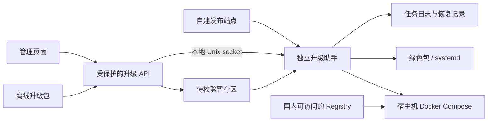

# 范围与选型

老板于 2026-10-15 确认继续，按本方案进入任务与测试拆解；站点地址及首批可升级来源版本仍需在发布前落定。

以需求规格为基线，首版按 Linux amd64/arm64、绿色包、systemd、单机 Docker Compose 设计，包含在线获取、离线导入和预先授权的无人值守维护窗口。
Windows 保持待定；本方案不包含 Windows 实现，不改动其安装脚本。
发布站点采用 HTTPS 静态清单与不可变制品目录，Docker 在线镜像来自自建或国内可访问的 Registry。
站点域名、存储和 Registry 厂商待部署时确定，客户端不依赖 GitHub API、GitHub 下载或 GitHub 登录凭据。

核心选择是独立 Go 升级助手 uvp-updater，保持与业务进程和业务容器分离。
不把长时间升级放在 HTTP 请求内，不依赖业务进程停止后继续执行自己的代码，也不依赖浏览器完成回滚。

# 当前代码事实与复用边界

以下为 2026-10-15 当前工作区核对，不代表部署环境已经具有这些能力。

| 位置 | 当前情况 | 方案处理 |
| --- | --- | --- |
| deploy/standalone/build-standalone.sh | 支持 amd64/arm64，输出完整 tar.gz 和摘要 | 保留 uvp-gb28181-linux-<arch>-<version>.tar.gz 命名，补充发布元数据与签名。 |
| deploy/standalone/uvp-gb28181-ctl.sh | 平铺布局，脚本按自身目录定位，部分初始化会写配置 | 保留启停入口，增加稳定根入口和显式共享路径，升级启动禁止重复首次初始化。 |
| deploy/standalone/uvp-gb28181-service-install.sh | oneshot + RemainAfterExit，按安装者身份执行 ctl | 保留业务用户与现有服务名；助手独立 unit，不能作为业务 unit 的子进程存活。 |
| deploy/test/deploy-uvp.sh | 有版本目录、摘要、锁与失败回切，但路径/服务固定，健康判断不足 | 参考思路，不直接作为产品升级器，也不修改当前测试部署路径。 |
| deploy/test/compose.yml | 本地 build，前后端分镜像，backend 只检查端口 | 新增正式发布 Compose 模板，使用已发布镜像及明确就绪检查。 |
| server/bootstrap/init.go | 正常启动会自动迁移后初始化缓存、权限和调度 | 增加升级维护门禁，迁移与候选版本验证期间不开放业务。 |
| server/app/gb28181/migration/runner.go | 有迁移记录和数据库锁；SQLite 文件内事务，其他方言逐条执行 | 复用迁移内核；不假设迁移失败会完整撤销，增加只读规划及结果核验。 |
| server/app/global/app/version.go | 从 version.json 读取名称和版本 | 增加构建时嵌入的 build_id，并与前端发布元数据和助手记录交叉核对。 |
| server/app/routes/routes.go | JWT、初始口令限制、演示账号限制、Casbin、操作审计 | 升级接口放入既有保护链，新增精确授权映射。 |

# 模块与数据流



- 后端负责转发检查结果、流式接收离线制品、权限校验和向助手提交任务；客户端请求只传发布标识、制品标识和任务标识。
- 助手负责在线检查与后台下载、最终可信校验、预检、持久任务、维护门禁、备份、迁移、切换、就绪验证和恢复，下载不绑定业务 API 请求的生命周期。
- 后端向页面转发助手状态，助手日志是任务事实来源，不依赖正在迁移的业务库。
- 首版使用短请求加轮询，不引入 SSE、消息队列或新数据库。停服期间页面显示重连，恢复后重新鉴权并读取原任务。
- 无人值守由助手内置受持久策略驱动的调度器执行；普通管理 API 只负责创建/暂停策略和查看任务，不依赖浏览器或后端长连接存活。
- CLI 提供本机 status、diagnose、resume 和兼容目标 rollback，网页不可用时仍能诊断；不提供任意 shell 执行能力。

# 发布站点与可信清单

统一路径约定如下，域名在正式发行构建中注入；开发版本不带虚构的可用站点。

```text
/uvp-gb28181/channels/stable/manifest.json
/uvp-gb28181/releases/<release_id>/manifest.json
/uvp-gb28181/releases/<release_id>/<artifact-file>
```

- stable 清单包含 schema_version、channel、递增 sequence、发布/过期时间、release_id，以及不可变版本清单的 URL 和 SHA-256。终端时间明显异常时提示校时，不跳过有效期验证。
- 版本清单包含 version、build_id、commit、变更说明、最低应用版本和助手协议版本；按部署方式、OS、架构列出制品名称、大小、SHA-256、解压大小及组件清单。
- 每种数据库单独声明允许的来源迁移记录指纹、目标迁移集合、回退策略、配置与随包依赖数据格式兼容性。最低版本字符串不能代替这些检查。
- Docker 条目同时记录 Registry 仓库、当前平台 manifest digest、image config ID、组件版本，以及离线镜像归档的大小和 SHA-256。
- 清单使用单文件签名信封：payload 为原始 JSON UTF-8 字节的 Base64，signatures 为 key_id 和 Ed25519 签名列表；签名覆盖解码后的完整 payload 字节。拒绝重复 JSON 字段、未知协议版本和超限内容，清单信封上限 1 MiB。
- 在线和离线均验证版本清单签名。在线额外验证 stable 签名、有效期、sequence 及其指向的版本清单摘要；不使用“下载失败就绕过校验”的降级。
- 终端内置可信公钥，签名私钥仅在 CI 密钥存储或离线发布机。助手才是最终验证方，后端验证不替代助手验证。
- 助手持久保存已接受的最高 stable sequence，拒绝旧在线清单重放；普通升级禁止降级或同版本不同构建，回退走独立流程。
- 离线包不携带有效期受限的 stable 清单，使用不可变版本清单；仍受来源版本、迁移兼容和禁止普通降级规则约束。
- 公钥轮换先通过受旧公钥信任的版本分发新公钥，再切换签名；过渡期可双签。首版不做在线任意公钥导入或自动信任新 key_id。
- 下载仅允许注册的发布源 HTTPS 地址；每次重定向重新校验协议、主机和端口，不转发凭据。私有镜像仓库凭据由宿主机 Docker 管理，不出现在清单或任务日志中。

发布顺序为：同一 commit 构建完整目标矩阵 → 核对版本与组件 → 摘要与签名 → 上传不可变目录和镜像 → 从实际下载地址验证 → 最后原子替换 stable 单文件。
版本目录禁止覆盖发布；修复错误内容须新版本。stable 使用短缓存并重新验证，版本制品可长期缓存。
CI 支持 dry-run，本地构建和矩阵验证不得隐式触发公开发布。

# 在线与离线制品

- 在线绿色包直接下载现有命名的完整 tar.gz，另取同版本签名清单；不改变原有安装包格式。
- 离线统一使用 .upgrade.tar 外层容器，内含签名版本清单及当前平台所需制品；绿色包保留原始 tar.gz，Docker 包含所需镜像的 docker save 归档及受管 Compose 模板。
- 外层容器流式读取，先限量读取并校验清单，再按清单核验每个文件；拒绝重复路径、缺件、额外可执行内容、绝对路径、越界路径、软硬链接及设备文件。
- 文件数、实际总大小和逐文件大小受限，不因清单声明很小就放弃实际读取限制；预检同时计算制品、解压、旧版本保留和数据库快照所需空间。
- 后端只写 inbox，助手从文件描述符复制到自己控制的 staging 后重新校验。特权助手不从业务可写目录执行文件，不允许用户传任意宿主路径。
- 预备完成后不占用业务停机窗口。应用前再次核对当前版本、配置摘要和迁移状态；变化后要求重新预检和确认。

# 助手安装、权限与持久任务

- 新包随附助手与公钥；旧安装通过一次可信引导工具接入。安装注册保存实际根目录、部署类型、业务 UID/GID、服务名或 Compose 项目标识、受管组件及共享数据路径。
- 绿色包助手以安装用户运行，由稳定 ctl 入口确保启动，以独立会话运行，业务 stop 不停止助手。
- systemd 助手采用独立常驻 unit；需要调用 systemctl 的执行层由管理员安装，所有业务 ctl 和组件继续以原业务用户运行，不能把数据属主改为 root。
- Compose 助手运行在宿主机，以 Docker 所需权限运行。业务容器仅挂助手专用 socket 目录，不挂 docker.sock；socket 目录与已有防火墙 agent 分开，不能暴露整个宿主 /run。
- 特权注册文件、助手可执行文件、公钥、任务状态与已验证 staging 不可由业务用户修改。绿色包同 UID 部署沿用安装用户的本机信任边界，不宣称能隔离同用户的恶意进程。
- Unix socket 限定业务 UID/GID，并核验本机对端身份；只能对注册实例提交 prepare、apply、status、rollback 等固定协议操作。禁止 shell 字符串、任意 unit、任意路径及任意 Compose YAML 输入。
- 首版助手协议固定 v1，应用包声明 min_updater_protocol；不兼容时阻止应用并提示升级助手。首版不实现助手自动自替换，助手升级由独立签名引导工具完成，避免执行中替换自身。
- 每个实例使用操作系统文件锁覆盖获取至恢复结果落盘的完整任务；幂等键绑定操作者、源版本、目标清单摘要及动作，不因 HTTP 重试重复应用。
- 状态位于版本目录外的 updater-state，采用写临时文件、fsync、rename、目录 fsync；记录不可逆动作前后的阶段和实际对象标识。锁由内核释放，恢复时不根据 PID 数字猜测任务已结束。

任务阶段：fetching → verifying → preparing → awaiting_confirmation → stopping → backing_up → migrating → activating → validating → committing → succeeded。
终态还包括 failed、rolled_back、recovery_required；停止前允许取消，进入 stopping 后不提供浏览器强行取消。
任务包含 task_id、操作者、时间、源/目标 build_id、制品摘要、进度字节、备份信息、实际切换记录、错误与恢复结果。
仅保留有限份已完成制品；不清理当前版本、回退版本、运行中任务及待恢复备份，不自动 docker image prune 或删除业务文件。

无人值守在 awaiting_confirmation 阶段使用策略决策：窗口未到、策略暂停、版本不在允许范围或要求人工确认时保持 awaiting_confirmation；窗口内且全部自动条件满足时写入 auto_approved_by_policy，再进入 stopping。策略版本、时区、窗口起止和触发的 stable sequence 必须持久化，防止重启后重复或越权应用。

# 无人值守策略

- 每个注册实例最多一个有效策略；策略变更递增 policy_version，应用任务保存创建时快照。策略暂停立即阻止尚未进入 stopping 的自动任务。
- 默认策略为 disabled。启用时必须由升级管理权限管理员明确提交，并要求确认部署类型、架构、时区、维护窗口、允许通道、自动重启和通知设置。
- 默认只允许补丁/小版本范围内的签名发布；大版本、rc、最低版本不匹配、迁移声明变化、随包依赖重大变化或回退条件不足时转为 manual_required。
- 维护窗口使用明确 IANA 时区，处理夏令时重复/缺失时刻；窗口结束时不开始新的停服阶段，已进入 stopping 的任务按恢复协议完成。
- 自动应用前仍执行空间、权限、配置摘要、迁移计划、备份可恢复性和候选启动检查。任一失败只生成阻止/失败任务，不自动放宽条件。
- 自动回退只允许清单声明兼容且已验证的目标；不满足时进入 recovery_required，并通知管理员，不执行数据库 RESTORE 或 down SQL。
- 无人值守不允许用户提供任意 shell、Compose YAML、下载地址、数据库命令或临时跳过签名/备份的开关。
- 通知采用事件模型：downloaded、blocked、auto_started、succeeded、rolled_back、recovery_required；首版至少落本地持久日志和管理页面，外部通知通过后续适配器加入。

# 绿色包与 systemd 激活

```text
<install-root>/
  uvp-gb28181-ctl.sh         # 稳定入口，不随应用版本切换
  current -> releases/<release_id>/
  releases/<release_id>/    # 已验证的代码、前端及依赖二进制
  config/ data/ logs/       # 用户配置、数据库、录像、上传、证书等共享内容
  runtime/<release_id>/    # 该版本生成的运行配置与临时文件
  updater/ updater-state/  # 助手、注册记录、任务及备份
```

- 新 ctl 显式区分 INSTALL_ROOT、RELEASE_ROOT 和 RUNTIME_ROOT；业务工作目录解析及 version.json 跟随版本，数据、证书、PID 和 process-authority 跟随固定共享路径。
- 包内声明可写路径，解包后的 config/data 不覆盖共享目录。仅为缺失的配置键生成建议，必填项在预检时处理；保留现有配置文件原件和变换前快照。
- nginx 模板属于版本制品，生成配置放 runtime；Redis 持久数据、ZLM 配置及证书不留在将被清理的旧版本目录。随包依赖的版本和数据格式兼容同样纳入回退策略。
- 激活顺序：写维护门禁 → 停止业务并确认退出/释放端口和数据库写句柄 → 备份 → 独立执行目标迁移 → staging 完成落盘 → 创建 current.next → 同文件系统 rename 替换 current → 启动候选版本验证。
- 单次 rename 仅保证目录指针切换，不把整个停服、迁移和重启流程称为原子事务；其余步骤靠任务日志和恢复流程保证可识别。
- 回退按记录恢复原 current、必要配置和兼容数据，再启动旧组件并验证；升级助手不会随业务停服而消失。
- systemd 使用注册的 unit 启停，保持原 User、开机自启和自定义服务名。测试环境“单后端 unit + 外置前端”的布局需单独登记组件，不假定等同于绿色包 oneshot。
- 平铺旧绿色包接入前识别所有可写路径、空间、属主和原启停方式；先保留旧安装快照，再在同一安装根迁移布局。失败可还原入口，不重建数据库、不重新生成凭据和授权域。
- 首次接入需要一次管理员执行；旧程序没有升级 API，不能承诺仅靠旧页面点击就能完成引导。之后升级通过页面执行。

# Docker Compose 激活

- 新增 deploy/compose 正式安装与发布模板，复用现有后端、前端构建资产；不把 deploy/test 当作通用产品部署。
- 注册时固定 project name、project directory、原配置来源、受管服务、卷/挂载与环境文件，禁止每次按当前目录猜项目。
- 预检用 docker compose config 得到实际配置，比较新旧有效配置，保留用户端口、挂载、环境和未知服务；只允许修改已注册服务的受管字段。新拓扑或不支持的自定义项阻止自动应用，展示必要接入说明。
- 在线先 pull 清单签名绑定的当前平台 digest，核对镜像平台、config ID 与版本标签，旧服务保持运行；应用阶段使用完整仓库 @sha256 引用，不用 latest。
- 离线先校验归档并 docker load，再核对实际 config ID 与签名清单。docker save/load 不保证保留 Registry RepoDigest，不能据此误判失败或伪称已验证 RepoDigest。
- 离线镜像用实例内受管唯一 tag，记录并在启动前后核对 config ID；设置 pull_policy: never，执行 --pull never --no-build，确保无外网也可重建。tag 本身不作为可信摘要。
- 应用时只停受管业务入口、backend 和需要变更的随包组件，不执行 compose down -v，不删除卷，不重启未纳入本次变更的外置服务。
- 用目标镜像运行受控一次性迁移任务，继承相同配置、网络和数据挂载；不启动普通业务入口。数据条件满足后启动候选服务并验证。
- 应用目标写入持久 compose.yml，不能只传一次性 IMAGE_TAG 或只改临时覆盖文件；稳定 ctl 封装相同 project。管理员之后按该项目标准命令重建仍使用目标版本。
- 接入时保留原配置快照；生成有效 Compose 配置所涉及的凭据文件权限为 0600，不写入 API 响应或普通任务日志。用户后续改动被检测后重新预检，不覆盖其修改。
- 回退恢复持久旧 Compose 配置、旧镜像引用及兼容数据，再以原 project 启动验证。保留旧镜像，禁止升级中自动清理镜像。

# 数据迁移、维护门禁与回退

自动升级允许路径由“源构建 + 当前迁移记录 + 数据库方言 + 目标清单兼容声明”共同决定，不依据版本号大小猜测。
增加只读 migration-plan，返回将执行的迁移、未知/缺失记录及数据库标识，不偷偷修复数据库。
多个数据库连接同时启用、目标不明确时阻止应用，要求先明确该实例实际使用的数据源；首版不协调跨库事务。

| 数据库 | 首版备份与迁移策略 | 失败恢复 |
| --- | --- | --- |
| SQLite | 全部写入者停止后，用随包 Go 工具通过 SQLite 一致性备份接口或 VACUUM INTO 生成快照并做完整性检查；不裸拷贝运行中的主文件。 | 候选版本尚未对外开放写入时，可停所有连接、保存现场并恢复快照及对应配置；检查 WAL/SHM，验证旧版后再开放。 |
| MySQL | 使用现场已有、版本适配的原生备份工具生成受保护备份并检查结果；仅放行已验证的兼容迁移路径。 | 旧版对完整或部分迁移状态都已验证兼容，且探测确认满足条件时才回切；否则保持维护状态等待受控恢复。 |
| PostgreSQL | 使用适配的 pg_dump 等现有原生工具，备份内容与工具版本纳入记录；兼容路径须逐版本验证。 | 不因为该数据库支持事务就认定当前逐语句执行的迁移文件原子；回切条件同上。 |
| SQL Server | 使用原生 BACKUP 并完成可用性核验，保留恢复目标信息；无备份权限时禁止应用涉及数据变更的版本。 | 不自动执行 RESTORE 覆盖用户库；不满足旧版兼容探测时进入 recovery_required。 |

- 随包 SQLite 备份工具扩展 uvp-setup，不依赖用户安装 sqlite3、Python 或数据库 CLI。外置数据库有数据变更而缺乏适用备份工具、权限或已验证恢复路径时，阻止应用，不能假设备份成功。
- 备份命令的凭据通过受限配置或安全输入提供，禁止写进进程参数和任务日志；自动化测试需验证备份可恢复，文件存在或退出码为零不足以证明完整恢复能力。
- 首版自动通道只发布经验证的向后兼容数据库/依赖数据迁移。破坏性变更不进入一键应用路径，给出受控维护升级说明；不额外实现通用数据库恢复平台。
- 维护门禁位于版本目录外，由助手管理并在重启后保留。正常业务启动、稳定 ctl 和候选实例均须遵守；检查点置于自动迁移之前，注册实例的门禁不可读时拒绝启动。不得在恢复判定前自动跑一次新的 Up。
- 目标迁移复用 -migrate-up，但先在独立受控进程中完成，并核验实际数据库标识与迁移记录。候选验证启动仅接受已验证目标迁移集合，禁止继续自动补跑未知迁移。
- 候选模式完成必要模块初始化、监听及内部探测，暂不开启对外业务写入、SIP 业务处理、录像任务、调度、上级注册和其他后台写入。维护门禁覆盖 HTTP、SIP、hook 和后台入口，不是前端遮罩。
- 验证通过后先持久记录 commit 决策，再开放业务并最终写 succeeded；开放后不得因助手重启自动恢复旧数据快照。此后手动回退须重新评估当前数据兼容性。
- 部分迁移、配置迁移或依赖持久数据已发生变化且无法证明旧版兼容时，保持维护并报告 recovery_required，不能仅回切二进制就宣称恢复。
- 数据库 down SQL 继续供已有运维入口使用；升级助手不自动拼接或逆序执行 down 文件作为通用回滚。

# 启动验证与断点恢复

- 新增内部就绪探测：返回 version、构建时 build_id、实例标识、候选 task_id、迁移状态、必需组件状态；仅助手本机/容器管理通道可读详细内容。
- 普通公开存活探测仅返回最少状态；不会把账号、配置、拓扑和数据库详情公开给未登录用户。
- 必查：目标进程身份和 build_id、数据库读探测与迁移集合、启用的缓存、SIP TCP/UDP 按实际配置绑定、必需的本地 ZLM API 及 hook 配置、前端入口和静态构建标识。
- 外置 ZLM 按既有节点必需性判断；不要求每台摄像机在线，也不为验收强行点播设备。随包 Redis/ZLM/Nginx 的实际二进制或镜像须匹配目标组件摘要。
- front/backend 采用同 release_id；前端资源含构建标识，静态 HTML 不长缓存，带 hash 的资源可长缓存，避免浏览器继续使用旧入口误报升级完成。
- 候选验证默认最多 180 秒，连续三次间隔两秒通过才提交；SQLite/外置库迁移独立于该时限，使用各步骤记录的期限，超时进入对应失败判定，不直接杀库。
- 助手恢复先读阶段和真实进程、current/Compose、镜像、门禁及迁移状态。停止前未应用的任务可恢复获取或等待确认；不可复用已经失效的预检。
- 已停止但尚未迁移时可验证旧版并恢复；迁移或切换中按记录和兼容策略恢复，任何不确定数据状态进入 recovery_required。
- 已记录 commit 决策则继续验证/开放目标，不执行旧快照恢复；已提交但未写成功的任务可补记成功，需再次确认实际目标身份。
- systemd 业务 unit 配置助手依赖与启动前恢复检查；Docker restart 策略可能先拉起容器，容器内启动门禁必须在迁移和业务初始化前阻止其抢跑。助手完成恢复后才允许受管业务启动；无 systemd 的纯绿色包在下次稳定 ctl start 时先恢复，不承诺宿主重启后自动启动。
- 单纯收到 HTTP 200、端口连通、Compose up 返回零或浏览器倒计时结束均不构成成功依据。

# API、权限与页面

建议统一 /api/system/upgrade，沿用项目响应格式，具体 DTO 在任务阶段锁定。

| 接口 | 用途与边界 |
| --- | --- |
| GET /status、/tasks/:id | 当前构建、部署能力、活动任务及恢复结果，要求查看权限。 |
| POST /check | 请求检查自建源，不接受用户任意 URL；网络失败与无新版本分开返回。 |
| POST /tasks | 创建指定 release_id 的在线准备任务，返回 task_id，不等待下载完成。 |
| POST /imports | 流式接收离线包并建立校验任务；明确路由上传上限和超时，不放宽全局超时。 |
| POST /tasks/:id/apply | 携带预检摘要和幂等键确认手动应用，短请求返回已持久受理的任务。 |
| GET/PUT /policy | 查看或修改无人值守策略；修改需要 manage 权限，保存策略版本和审计记录。 |
| POST /tasks/:id/cancel | 仅在停止业务前取消。 |
| POST /rollback | 创建指向已验证兼容版本的回退任务，同样预检、确认和记录。 |

- JWT、初始口令限制、演示账号限制、Casbin、操作审计均复用；新增 system:upgrade:read 和 system:upgrade:manage，默认仅超管授予 manage，不扩大已有普通管理员权限。
- 上传采用专用流式路径，完整文件落盘后由 API 返回持久 `job_id`（兼容字段 `upload_id`）；后台助手校验不依赖 HTTP 请求存活。客户端断开不会取消已受理任务；上传未完成则清理半包且不受理。首版失败重新上传，不增加断点续传协议。详见 [异步导入契约](../specs/service-upgrade-async-import.md)。
- 入口放在系统管理的“服务升级”，显示当前版本、更新内容、部署方式、在线检查和离线导入；预检及确认只显示用户可决策的信息。
- 重启前保存 task_id，刷新后先查询活动任务再展示新版本；助手恢复后的事实覆盖浏览器缓存，失效登录返回登录页后仍可查原任务。
- 审计上传/应用/回退时记录摘要、版本和结果，不记录 multipart 正文、数据库凭据或完整备份路径；助手保留执行记录供业务恢复后关联同步。

# 代码落点、验证与权衡

预计新增 server/internal/upgrade 共用清单、状态机和部署适配器，server/cmd/uvp-updater 助手入口，server/app/service 与 controllers 的受保护 API，web/src/views/system/upgrade 页面。
新增 deploy/updater、deploy/compose 和发布打包/签名脚本；定点修改 standalone 的路径、启动门禁与构建、bootstrap 的候选模式、迁移只读规划与版本身份。保持现有防火墙 agent 和设备固件升级边界独立。

任务阶段逐项绑定 spec 的 AC-01 至 AC-14，先定义失败用例再实现：

- 单元层覆盖签名/摘要、解析、路径与体积限制、版本兼容、幂等、状态恢复、数据库/组件回退判定。
- 隔离 Linux VM/容器覆盖两种架构、三种部署、断网、半包、空间不足、错版本进程、迁移中断、SIGKILL、宿主重启及恢复；涉及重启的验收必须使用 VM。
- 四种数据库分别使用可丢弃测试库验证备份恢复、迁移和旧版兼容，不能以 SQLite 测试替代其他方言证据。
- Docker 验证镜像引用、实际 config ID、卷与端口保留、离线无拉取、升级后再次重建，以及失败回退后的再次重建。
- 真实管理页面验证权限、上传、阶段提示、刷新恢复和登录失效；不能仅以接口或组件断言代替浏览器验收。
- 发布验证完整矩阵、签名密钥边界、自建源无 GitHub 依赖、stable 最后切换和 dry-run 不发布。

独立助手和候选维护模式比单文件覆盖成本高，但它们解决整包重启后的执行存活、数据一致性和容器重建问题，属于本次目标所需范围。
首版通过限制已验证升级路径控制复杂度；不引入 Provider 插件、消息队列、集群协调或通用数据库恢复框架。

# 待评审项与进入下一阶段条件

1. 确认独立助手、静态签名发布站点、三种部署适配和 Docker 离线导入这一方案。
2. 确认首版 Linux amd64/arm64；Windows 后续独立适配，不能按本方案宣称已支持。
3. 确认破坏性数据库/随包依赖数据变更首版阻止一键应用，采用明确的受控维护流程。
4. 发布域名、Registry 和首批可升级来源版本在上线前落定；协议和本地测试可先完成，不写虚构生产地址。

5. 无人值守按“默认关闭、管理员预授权、维护窗口自动应用、条件不满足则阻止或恢复”的策略进入实现；若需要更宽松的自动升级范围，应先修订本方案和测试矩阵。

本方案已进入带测试用例的任务拆解，见 ../tasks/service-upgrade.md。方案阶段未执行编码、测试库迁移、真实发布或部署。
